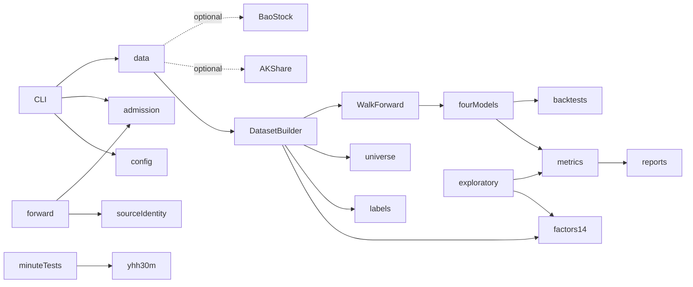

# Extraction dependency graph

Production: NumPy, pandas, SciPy, sklearn, LightGBM, XGBoost, PyArrow,
Matplotlib, PyYAML and tzdata. Testing/build: pytest, coverage, setuptools,
wheel, build; black/flake8 for development. Suppliers: AKShare/BaoStock;
PDF/workbook parsing: pypdf/openpyxl; HTTP libraries are provider dependencies.
GUI, brokerage SDKs, Qlib and Backtrader are not part of the extracted tree.

## Physical and identity dependencies requiring migration

* config/loader.py:31-41 discovers an ancestor containing qbot/ and README.
* forward/integrity.py:107-162 binds qbot/research plus old requirements.
* diagnostics/model_readiness/source_identity.py reads committed Git blobs
  under qbot/research and requires an exact repository root.
* data/csmar/fingerprint.py:36-81 follows AST imports and config bytes from a
  root inferred from the old source layout.
* exploratory runners bind source paths and software identities.
* model_readiness and market_structure intentionally use namespace packages;
  wheel discovery must include directories without __init__.py.
* Historical reports, C-01 preservation and frozen delivery tests require
  old paths, commits and evidence. They are not authorization for new bytes.

## Independent security controls

market-admission.yml pins a separate trust anchor; research_checks.py verifies
its checker before loading it. C-01 has frozen legacy/source/reviewed commits.
All old control bytes were retained unmodified. The candidate cannot approve
its own control migration. Independent review remains a release blocker.
