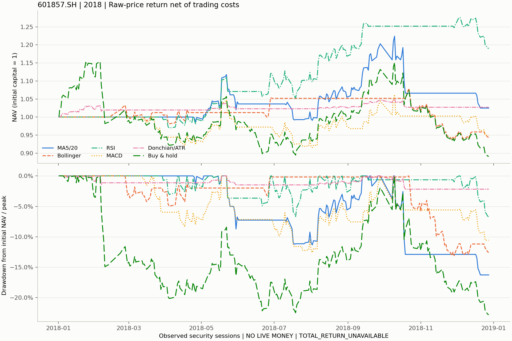

# P5-R02：真实历史六策略对照

2026-11-10 · **P5_R02_EXPLORATORY_REAL_COMPARISON_COMPLETED**

`EXPLORATORY_REAL_DATA / NO LIVE MONEY / PIT_UNVERIFIED / HFQ_UNVERIFIED / FORMAL_ADMISSION_BLOCKED`

## 样本、参数与共同口径

实际读取既有 CSMAR prepared-v4，601857.SH；2017-01-03—2018-12-28 共487个观察会话，
其中2017年244个会话预热，2018-01-02—2018-12-28的243个会话研究。manifest及实际消费的行情、
观察日历、事件候选和来源引用均通过内容身份核验，未下载、补日或替换成合成行情。
源manifest SHA256：`d77417709364d664f1041418c51a434e836a72cbebbc53f7b2158556478ccb64`。
这是2026-11-05准备的回顾性数据版本，不是2018年已知的历史快照。

[固定配置](../../../configs/research/p5-r02-601857-2018.json)在首次计算前选用现有实现的默认参数；没有参数搜索或按结果选优：

|方案|固定信号参数|
|---|---|
|MA5/MA20|5/20日均线交叉|
|Bollinger|20日、2倍标准差、mean_reversion；下轨重入买入，中轨退出|
|RSI|Wilder 14日、30/70；上穿30入场、下穿70退出|
|MACD|12/26/9、zero_filter=false|
|Donchian/ATR CTA|入场20日、退出10日、ATR14、趋势50、3倍ATR止损、1%风险预算|
|Buy and Hold|研究前预先确定的首次研究开盘买入指令|

六方案初始现金均为100,000元，单证券上限100%，100股整手，只做多；
佣金3bps、最低5元、滑点5bps、转让费0，2018年卖出印花税10bps。
滑点为单列现金成本，不再修改成交价。费用为固定研究假设。

信号显式选择`raw_close`，CTA使用原始高低价；不将原价改名为复权字段。
现有信号API默认仍为`adj_close`，独立研究适配器移除供应商`adj_*`输入，只消费原价。
策略收盘生成目标，最早下一可执行开盘成交；基准的首次开盘指令事前已知，不从该日收盘信号推导。
同一个`run_target_positions`、`AShareExecutionBacktester`及`FeeSchedule`负责六方案；
正目标只用于空仓入场，不每日再平衡。预热期不携单，停牌、涨跌停、T+1、现金与整手约束完全共用；
未成交意图按既有执行器重试或被后续目标取代，期末不强制平仓。

## 实际风险收益

主表统一为 **RAW_PRICE_RETURN_NET_OF_TRADING_COSTS**，不包含公司行为现金流。
年化252会话、无风险年利率0、样本波动率ddof=1；最大回撤包含交易前初始净值1。
所有净值均为当日权益/100,000，首日费用和开盘至收盘波动保留，不按各自首次收盘重新归一。

|方案|累计收益|年化收益|年化波动|Sharpe|最大回撤|Calmar|相对买入持有|
|---|---:|---:|---:|---:|---:|---:|---:|
|MA5/MA20|2.4876%|2.5809%|18.9501%|0.2292|−16.2688%|0.1586|15.0300%|
|Bollinger|−5.6309%|−5.8333%|10.2134%|−0.5375|−13.0947%|−0.4455|5.9179%|
|RSI|18.9812%|19.7495%|15.8780%|1.2136|−6.7262%|2.9362|33.5421%|
|MACD|−5.0128%|−5.1936%|17.6562%|−0.2147|−12.5956%|−0.4123|6.6117%|
|Donchian/ATR CTA|2.7163%|2.8183%|3.8359%|0.7437|−2.1801%|1.2928|15.2867%|
|Buy and Hold|−10.9036%|−11.2838%|26.0531%|−0.3290|−22.8057%|−0.4948|0.0000%|

“相对买入持有”是同一初始权益、同一243会话的期末财富比`NAV策略/NAV基准−1`；
收益率差另存`excess_return`，例如MA为13.3912个百分点，RSI为29.8848个百分点，两者不混用。



图中颜色和线型同时识别策略；完整逐日表保存在私有输出，汇总表提供数值视图。

## 成交、成本与资金占用

换手率为逐日单边成交额/上一收盘权益之和，首日分母为初始资金；并非买卖额除以2。
成交次数指有正成交额的订单，不是完整买卖回合。持仓时间为收盘股份大于0的会话占比。

|方案|成交次数|累计换手|费用不含滑点（元）|滑点（元）|全部成本（元）|拒单记录|持仓会话/比例|期末权益（元）|
|---|---:|---:|---:|---:|---:|---:|---:|---:|
|MA5/MA20|8|793.3481%|656.9274|409.4690|1,066.3964|1|88 / 36.2140%|102,487.6036|
|Bollinger|9|897.2482%|674.6030|452.3250|1,126.9280|0|80 / 32.9218%|94,369.0720|
|RSI|5|498.2298%|400.4930|281.3400|681.8330|1|121 / 49.7942%|118,981.1670|
|MACD|12|1,189.5415%|919.8167|575.9845|1,495.8012|3|115 / 47.3251%|94,987.1988|
|Donchian/ATR CTA|6|115.8922%|96.6772|58.9900|155.6672|0|87 / 35.8025%|102,716.3328|
|Buy and Hold|1|99.5070%|29.8521|49.7535|79.6056|0|243 / 100%|89,096.3944|

所有5条拒单记录都是`cash_constraint`的100股部分拒单，并非整笔交易未成交：
MA发生在12月18日，RSI在3月30日，MACD在7月2日、9月14日、12月4日。
执行器按含费用预算缩减一手后成交，没有透支。日期、信号日、成交股份、成本及拒单原因逐笔见
[派生成交收据](real-summary.json)；原始成交价及完整账本只保留在私有目录。

Bollinger、RSI、买入持有期末分别保留13,000、16,500、12,300股，按末日原始收盘估值；
其余方案期末空仓。六方案末日均无执行器待成交目标，最后收盘目标仍另存于指标与信号文件，不补造窗外成交。

## 如何解释差异

RSI在该窗口的累计收益、Sharpe及Calmar最高；这描述固定参数的本次样本结果，不是参数选择结论。
它持仓121个会话，明显少于基准的243个会话；MA和MACD则更频繁进出。
Bollinger与MACD虽跑赢下跌的基准，自身仍为负收益；MACD的12次成交及1,495.8012元成本也高于RSI。

CTA回撤和波动较小，不能直接归因于更强的择时：它采用原实现的ATR风险预算，
全窗口平均市值/权益仅6.7607%，而MA、Bollinger、RSI、MACD、基准分别约为
36.1184%、32.8646%、49.6265%、47.1136%、99.5824%。
同样的仓位上限并不等于同样的实际风险暴露，本实验不增加杠杆或事后配平风险。

样本仅为单只股票、单个研究年度。各策略均未通过独立参数选择及多年样本外盈利检验；
收益差异可能来自市场环境、持仓时间、仓位预算与交易次数。
这是回顾性价格研究，不构成普遍有效的Alpha证明。

## 公司行为与来源边界

已检查#58的分红账本及其`DividendExecutionPlan`合同：需要完整区间覆盖、原始事件与修订关联、
登记/除息/支付日期、字段级来源及税务合同；当前CSMAR的`action_coverage=PARTIAL`不满足这些条件。
真实持有期税仍为UNKNOWN，送转/配股不能按现金分红账本处理。
因此六方案均标记 **TOTAL_RETURN_UNAVAILABLE / null**，没有把分红、税或送转缺失视为0。
四条已知现金候选中研究期除息日为2018-06-21、2018-09-21；原价除息影响仍保留在信号和净值中。
TODO：取得完整事件、税务及受控执行计划后，另建总收益实验，不改写本次价格收益。

观察日历不是独立认证的官方交易日历，历史首次分发与修订链未知；状态来自回顾性原生映射。
涨跌停按昨日原始收盘近似，未作除息参考价调整；日线无法证明盘口排队或容量。
源manifest原有`execution=BLOCKED`、`formal_return_backtest=BLOCKED / NOT_RUN`保持原样，
本次探索计算成功不升级任何正式资格，也不认证HFQ。

有界检查现有候选的顶层和prepared manifest，只发现同一601857/2018样本的v2/v3/v4版本，
没有足以直接加入其他证券/研究年份的prepared身份，故不开展第二阶段扩展，不从收益反选样本。

## 复现与验证

基线为最新`origin/main`的`60c42536b289addcd87f34a4f0a0627bfa996d6c`。
实际最终运行代码为`ee0040016604d79b5ae8c6d4eb82b568e9e0e22b`，运行时工作树干净；
Python3.13.9，NumPy2.3.4、pandas2.3.3、PyArrow22.0.0、Matplotlib3.10.7，Windows11。
保存配置SHA256：`29812a8474b7152249c87e132b3af4975899e462c57e1e8b9e64167c9bc881ae`。

```sh
python -I -B -X utf8 tools/research/run_real_strategy_comparison.py --config configs/research/p5-r02-601857-2018.json --source-root '<CSMAR_PREPARED_V4>' --output '<NEW_PRIVATE_OUTPUT>'
python -I -B -X utf8 tools/research/run_real_strategy_comparison.py --config '<PREVIOUS_OUTPUT>/config.json' --source-root '<CSMAR_PREPARED_V4>' --output '<NEW_PRIVATE_REPLAY>'

python -I -B -X utf8 -c "import sys; sys.path.insert(0,'src'); import pytest; sys.exit(pytest.main(['-q','-p','no:cacheprovider','tests/research/test_real_comparison.py','tests/research/test_technical_strategies.py','tests/research/test_dual_ma.py','tests/research/test_exploratory_real.py']))"
```

[定向测试](targeted-tests.xml)：**113 passed，14.73秒**。
覆盖共用费用与基准、原价/复权隔离、未来数据扰动、下一开盘时序、停牌拒单与重试、未成交意图、
逐日现金/股份/净值对账、固定输入重放，以及既有技术策略、双均线与探索入口回归。

真实最终运行与保存配置重放的36份确定性产物哈希全部相同；六策略逐日股份、现金、权益、收益及成本对账通过，
最大现金舍入残差不超过2.92e−11元。收据、环境、Git commit/tree、源manifest身份和输出哈希见
[real-summary.json](real-summary.json)。私有manifest另保存逐Python源码内容身份和复现命令。

私有输出包括输入原价快照、日历、各方案`*_signals.csv`、`*_trades.csv`、`*_rejections.csv`、
`*_nav.csv`、`*_evaluation.json`、`metrics.json/csv`、统一净值/回撤图及不可变ExperimentTracker。
供应商行情、完整账本、事件原文与来源引用均不提交公开仓库。源目录不可访问时入口保存六方案的
`DATA_UNAVAILABLE`状态和复现命令，并以非零码退出，不输出收益；manifest漂移直接拒绝运行。
