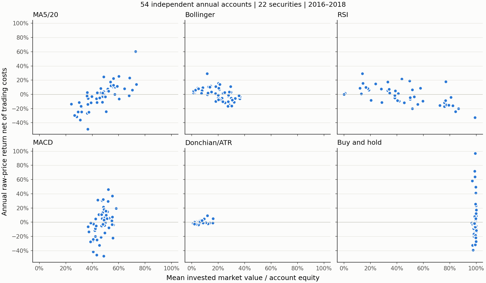

# P6-R01：真实多证券、多年份技术策略稳健性

2026-11-10 · **P6_R01_REAL_ROBUSTNESS_COMPLETED**

`EXPLORATORY_REAL_DATA / NO LIVE MONEY / PIT_UNVERIFIED / HFQ_UNVERIFIED / FORMAL_ADMISSION_BLOCKED`

## 结论：没有发现六策略中可认证的稳定优势

在事前固定的**22只证券、2016—2018年54个独立证券年度账户、324条策略结果**中，
没有一种主动策略同时表现出稳定盈利、稳定跑赢同证券买入持有，以及跨年份、跨行业的一致性。
Bollinger平均收益略正，但不足以说明稳定优势：仅44.44%的账户跑赢基准，且去除单只证券后均值可转负。
CTA最常跑赢基准，但平均收益仍负，平均资金暴露仅5.73%；低回撤主要与低仓位一致，而非已证明更强的趋势择时。
RSI在中国石油2018年的18.98%是本轮2018年19个证券账户中的最高值，不代表典型表现。

这里的“完成”指预设真实跨样本研究已执行，不是策略金融准入或盈利认证。

## 样本在收益计算前固定

基线为最新`origin/main`的`88652d8a1f2b37a0140586c49497a235950510b7`，复用D01提交`84d7aad`及证据字节固定提交`1a223d9`。
[D01报告](../p6-d01/REPORT.md)与最终合同交付后，先按数据覆盖生成并保存
[frozen-sample.json](frozen-sample.json)，再运行任何本轮真实策略。
输入manifest固定为`800d8413ee7d2b0adc90adde6b38f5b290f12cd08189515afecf49268bde876a`；
唯一行情快照固定为`795d567e6ae3af6d96c7ab454f2dae4ca6f07f3cb481a934327a1b3c10d90611`。

候选沿用D01固定的24证券、2015—2018年，不按收益添加替代证券。
完整年度至少240观察会话，前一日历年至少50预热会话，全部查询必须位于该证券同一个D01合格连续区间。
本批实际前一年完整观察为244会话；不能跨缺价停牌日拼接数据。
96个候选窗口中保留54个，排除42个，逐项原因均在冻结文件：
2015年24个窗口因缺2014预热排除；其他18个因预热或研究区间含拒绝会话排除。

|研究年度|合格证券账户|说明|
|---|---:|---|
|2015|0|没有前一年预热|
|2016|15|完整年度及2015预热|
|2017|20|完整年度及2016预热|
|2018|19|完整年度及2017预热|

总计22只不同证券，银行、保险、能源、证券、工业五组。
预先规定至少12只、3个完整年度、4个类别才标记真实稳健性研究完成；本批满足该标准，不能理解为实现了全部2015—2018候选覆盖。
行业标签是经济类别，不是历史时点认证行业分类。数据完整性筛选也会偏向少停牌、长期存续证券，不能代表全市场。

## 统一合同与汇总分母

六策略信号与参数完全沿用[P5-R02配置](../../../configs/research/p5-r02-601857-2018.json)：
MA5/20；RSI Wilder14、30/70交叉；MACD12/26/9且无零轴过滤；Bollinger20/2均值回归；
CTA Donchian20/10、ATR14、趋势50、3倍ATR止损、1%风险预算；买入持有为事前固定首次开盘指令。
没有参数搜索、训练或按观察改变规则；外部证券与跨时间固定参数比较不等于正式样本外盈利认证。

每证券每年度独立空仓、初始10万元、预算上限100%、100股整手、仅做多；年度间重置，不跨年延续持仓。
共同收盘信号、下一可执行开盘成交、T+1、停牌及涨跌停约束、失败意图处理，期末按原始收盘估值、不强制平仓。
复用`compare()`、`run_target_positions()`、原执行器、`ResearchEvaluation`和`ExperimentTracker`，未新建交易引擎或绩效系统。
佣金3bps/最低5元、滑点5bps、转让费0、卖出印花税10bps为统一研究假设，不宣称历史券商费率认证。
CTA风险参数未改变。

收益统一`RAW_PRICE_RETURN_NET_OF_TRADING_COSTS`；总收益为不可用/null，不混入现金分红与再投资。
累计收益为期末权益/初始资金−1；年化252会话、无风险0、样本波动ddof=1、回撤包含初始净值1。
相对基准财富比与收益率差分别保留；跑赢定义为收益率差严格大于0，盈利严格大于0，零收益不计盈利。

下表“账户”分母为54。证券级比例分母为22，先对每只证券可用年度收益/超额收益作算术平均再判断正负，
证券可用年数另存，不能与账户比例混用。
独立账户统计不是组合收益；本研究不输出合成组合Sharpe或真实组合交易收益。

## 跨样本结果

|策略|账户平均收益|中位收益|最差—最好|盈利账户|跑赢账户|盈利证券|跑赢证券|
|---|---:|---:|---:|---:|---:|---:|---:|
|MA5/20|−2.69%|−2.24%|−48.98%—60.14%|46.30%|44.44%|22.73%|45.45%|
|RSI|−1.67%|0.00%|−32.61%—29.21%|38.89%|55.56%|40.91%|40.91%|
|MACD|−1.75%|−2.23%|−47.83%—46.16%|44.44%|40.74%|36.36%|45.45%|
|Bollinger|0.18%|1.33%|−16.88%—29.05%|51.85%|44.44%|50.00%|45.45%|
|Donchian/ATR CTA|−0.20%|−0.56%|−3.76%—9.26%|35.19%|64.81%|50.00%|54.55%|
|买入持有|1.60%|−4.56%|−39.24%—96.91%|31.48%|0.00%|45.45%|0.00%|

这些是可用账户的分布，而非按同一股票池连续投资的年化组合表现。
[overall.csv](overall.csv)另给四分位数，
[account-metrics.csv](account-metrics.csv)提供全部324条账户的年化收益、Sharpe、波动率、最大回撤、Calmar、成交、换手、成本、资金暴露、持仓时间和拒单原因。

### 市场年份显著改变排序

下表为当年合格证券账户收益算术均值，年度间股票池数量和组成不同：

|策略|2016（15只）|2017（20只）|2018（19只）|
|---|---:|---:|---:|
|MA5/20|6.09%|7.20%|−20.03%|
|RSI|5.12%|1.13%|−9.98%|
|MACD|13.51%|6.16%|−22.11%|
|Bollinger|−6.60%|3.21%|2.34%|
|CTA|−0.43%|0.85%|−1.14%|
|买入持有|−5.16%|24.96%|−17.65%|

2017年主动策略跑赢比例仅15%—25%；2018年Bollinger/CTA均跑赢17/19，但CTA仅2/19盈利。
“跑赢下跌市场”与“绝对盈利”必须分开。
年度和年度×行业完整分布见[annual.csv](annual.csv)、[annual_industry.csv](annual_industry.csv)。

### 行业差异与单证券影响

Bollinger账户平均收益在工业组3.19%、保险0.72%，能源为−2.46%；
MA只有能源组均值为正（1.61%），MACD在能源/保险略正，其余负；
RSI仅能源组略正（0.52%），其他四组均负；CTA仅保险组正（0.51%）。
类别样本和年份重叠不均，这些是描述性分组，不是行业Alpha识别。全部数值见[industry.csv](industry.csv)。

逐证券剔除统计先算各证券可用年度均值，再对剩余证券等权，避免多覆盖年份自动赋予更高权重：

|策略|全部22证券等权平均年度收益|剔除任一证券后的范围|
|---|---:|---:|
|MA5/20|−2.84%|−3.55%—−2.13%|
|RSI|−2.08%|−3.08%—−1.05%|
|MACD|−2.08%|−2.59%—−1.38%|
|Bollinger|0.29%|−0.22%—0.99%|
|CTA|−0.36%|−0.49%—−0.20%|
|买入持有|0.94%|−0.23%—2.17%|

Bollinger微小正均值及基准正均值对单证券敏感，其他主动策略的负均值不因删除任一单证券转正。
[leave_one_security_out.csv](leave_one_security_out.csv)保留证券身份与均值变化；
[security_consistency.csv](security_consistency.csv)记录逐证券可用年数、盈利年份与跑赢年份占比。

## RSI：18.98%是有利个例，不是稳定典型

中国石油RSI在2016、2017、2018分别为**−4.37%、5.93%、18.98%**。
2018年的18.981167%与P5-R02复现一致；它是本轮2018年19只证券的最高值，
全54个RSI账户中仅3个达到或超过该值（包含它自身），并非总体典型结果。
2018年RSI只有3/19盈利，平均亏9.98%，但13/19跑赢基准：相对优势主要表现为减少下跌损失，不能误读为普遍正收益。

基准下跌的37个账户中，RSI平均−3.51%，基准−12.58%；
基准非负的17个账户中，RSI仅2.34%，基准32.48%。这与防跌/较低持仓解释一致，但不能把相关性当作严格择时因果分解。
本轮RSI平均资金暴露40.65%，2018年却升至63.85%，说明其逆向入场在持续下跌中也会长期持仓并亏损。

RSI平均每账户仅1.69笔成交，8/54完全没有成交。
按连续持仓段（含开仓、平仓成本，未平仓段也计）分解权益变化，有交易账户的最大持仓段绝对盈亏占比中位数为100%，
很多年度由单段持仓决定。中国石油2018共3段，最大盈利段18,104.381元，
相当于最终净盈利18,981.167元的约95.38%；另有亏损段，不能据最终收益推断信号高频有效。
[holding-episodes.csv](holding-episodes.csv)给出各账户段数、极值与集中度。
这里的集中度不是完整买卖回合胜率；样本很少，也不作为显著性检验。

## CTA：低回撤首先应与低风险暴露一起读

|策略|平均资金暴露|平均持仓会话占比|平均年度最大回撤|平均成交笔数|平均全部成本/初始资金|
|---|---:|---:|---:|---:|---:|
|MA5/20|46.90%|47.28%|−17.87%|15.70|1.96%|
|RSI|40.65%|41.00%|−13.23%|1.69|0.20%|
|MACD|47.28%|47.67%|−17.78%|18.52|2.33%|
|Bollinger|20.21%|20.36%|−10.69%|7.59|0.95%|
|CTA|5.73%|31.11%|−2.50%|7.76|0.18%|
|买入持有|99.21%|100.00%|−23.48%|1.00|0.08%|

CTA持仓时间约31%，但实际资金暴露只有5.73%，明显是ATR预算下的小仓位，不是仅靠持仓天数少。
其成交频率约7.76笔、范围2—15笔，并不比RSI更少；因此“少交易”不能作为低回撤的主要解释。
仅3条CTA拒单（2条现金约束、1条开盘涨停买入约束），不支持执行阻断普遍压低风险的解释。
缺价停牌窗口已在所有策略运行前共同排除，不能在这些账户内验证停牌风险。

CTA2018年平均暴露进一步降为2.33%，而2017年7.81%；这与趋势过滤、入场时段及ATR仓位共同变化一致。
CTA仍在各年度和行业间变号，整体平均负收益；收益与基准年度收益的描述性相关为0.66。
本研究没有做改变CTA预算的风险配平对照，因此不能精确分离低仓位与趋势信号的因果贡献；
证据支持低暴露是低回撤的重要解释，不支持把低回撤单独归功于趋势信号。
不把收益除以平均仓位宣称为可实现满仓收益。



每点为独立证券年度账户；各策略分面共用坐标，不是组合有效前沿。
静态浅色图以分面标题标识策略，数值视图见[exposure_cost_returns.csv](exposure_cost_returns.csv)。

## MA、MACD、Bollinger：方向、震荡和成本

MA/MACD与基准年度收益相关分别约0.76/0.64；
基准非负账户中均值为11.70%/10.21%，基准下跌账户中为−9.30%/−7.24%。
它们在2016较好、2018显著恶化，不能从中国石油2018的MA正收益推广到同年其他股票。
MA2018仅1/19盈利，MACD2018无盈利账户。

MA/MACD平均换手约15.55/18.32，定义为逐日单边成交额/前收盘权益之和（首日分母为初始资金），平均全部成本约1,959/2,327元，明显高于RSI与CTA。
其收益与成交笔数相关约−0.40/−0.44，与反复进出伴随较差表现一致；
但成本也是交易机会与成交额的结果，不能单凭相关性声称成本造成全部亏损。
这些成本直接包含在账本，不能将成本简单加回当成另一套零成本可实现收益。

Bollinger平均资金暴露20.21%，2018平均正收益但2016平均负收益；
收益与暴露相关约−0.50，不是仓位越大表现越好。
震荡描述采用同账户买入持有净值的`abs(sum(log daily return))/sum(abs(log daily return))`路径效率，
它含基准首次成本，不能解释为纯原价趋势强度。
按事后描述阈值0.1分组的表见[path_efficiency-groups.csv](path_efficiency-groups.csv)；
收益与路径效率相关MA0.25、MACD0.14、Bollinger0.20，解释力不足以声称稳定的震荡/趋势适应性。
这些分组只解释现有结果，没有回流改策略、筛样本或优化阈值。

## 可追溯性、验证与不确定性

[real-summary.json](real-summary.json)保存真实完成状态、最终D01身份、冻结样本身份、运行代码基线/tree、
实际运行的三份编排/比较源码内容身份、环境、全部派生账户指标及汇总。
首次真实运行工作树含本任务新增代码，故`dirty=true`如实保留；基线提交不能冒充新增实现身份，实际源码哈希另列。
Python3.12.7；当前输入为2026整理的回顾性版本，不是2015—2018历史已知快照。

定向测试：**22 passed，11.62秒**，包含批量合成接口、原比较器回归及D01消费边界。
覆盖独立账户与直接单账户一致、资金暴露、分组分母、剔除敏感性、亏损保留、重复/缺腿拒绝、前一年预热与区间资格、
缺输入阻塞摘要，以及D01原价字段、身份漂移、PIT拒绝等边界。
合成测试不参与实证指标。真实计算324条评价均由同一既有评价器产生。

证券共享行业与年份冲击，不是54个独立同分布样本。只研究3年、可用证券不均、存续及停牌覆盖选择偏差、
观察日历而非独立官方日历、历史ST与身份代理、公司行为与来源修订链不全，均限制外推。
原价除息和未核算送配/重组会影响信号与净值；不作总收益解释，不认证HFQ。
未作独立统计显著性认证，剔除敏感性是描述性稳定性检查，不是不确定性置信区间。
统一费用与日线开盘涨跌停模型不证明真实排队、容量和交易可行性。

TODO：在完整公司行为、历史身份/PIT、官方日历及真实费率证据补齐后，通过既有准入另建总收益及交易可行性研究；不改写本次价格收益结果。

## 复现

```sh
python -I -B -X utf8 tools/research/run_strategy_robustness.py --config configs/research/p6-r01-strategy-robustness.json --research-root '<P6_D01_RELEASE>' --source-root '<EXISTING_P5_R03_ROOT>' --output '<NEW_PRIVATE_OUTPUT>'
python -I -B -X utf8 tools/research/summarize_strategy_robustness.py --input '<PRIVATE_OUTPUT>' --output '<NEW_DERIVED_REPORT_DIRECTORY>'
python -I -B -X utf8 -c "import sys; sys.path.insert(0,'src'); import pytest; sys.exit(pytest.main(['-q','-p','no:cacheprovider','tests/research/test_strategy_robustness.py','tests/research/test_real_comparison.py','tests/research/test_multisecurity_input.py']))"
```

D01适配器一次加载并核验唯一行情，窗口查询复用内存；没有参数网格、全市场扫描或并行框架。
保存配置、冻结样本、逐策略信号/成交/拒单/逐日净值/评价和ExperimentTracker保存在私有输出；
公开仅发布配置、覆盖窗口、派生统计与图，不发布原始行情或完整逐日账本。
