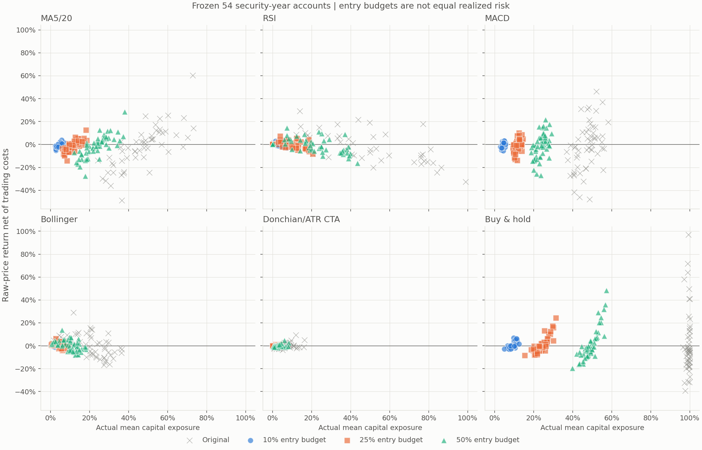

# P7-02：固定资金预算下的真实六策略比较

2026-11-10 · **P7_02_REAL_RISK_COMPARISON_COMPLETED**

`EXPLORATORY_REAL_DATA / NO LIVE MONEY / PIT_UNVERIFIED / HFQ_UNVERIFIED / FORMAL_ADMISSION_BLOCKED`

## 控制预算之后，排序没有改变；CTA仍是小仓位而非已识别的低风险Alpha

在冻结的22只证券、2016—2018年54个证券年度账户中，原始基线与10%、25%、50%三档预算下，六策略的**账户平均净收益排序完全相同**：买入持有、Bollinger、CTA、RSI、MACD、MA。三档均没有主动策略的账户平均净收益超过同预算买入持有；Bollinger的微小正均值对单证券敏感，CTA均值仍负。

CTA在同预算系数下的平均最大回撤仍明显最小，但其实际资金暴露并未与其他策略配平。10%档CTA平均暴露仅0.344%，买入持有9.169%、MA4.464%；CTA有18/54个账户零成交。因此这里观察到的是**保留原风险仓位规则后的固定预算缩放效果**，不是等实际风险实验。

一个有帮助的量级对照是：原始CTA平均最大回撤−2.501%，10%预算买入持有为−2.499%，MA为−1.878%、MACD为−1.841%、RSI为−1.270%、Bollinger为−1.007%。仅降低资金预算，其他信号乃至买入持有也能达到原CTA的低回撤量级。这支持低暴露是重要解释；不能据此估计CTA低回撤中有多少百分比由暴露造成，也不能把剩余差异解释为Alpha。

## 运行前固定的设计与身份

[预注册配置](preregistration.json)在真实运行前随实现提交为`e399b30`。分支基于执行时最新`origin/main`：`2fffbee`。没有参数搜索、收益筛选或重复运行相同真实情景。

- 冻结样本直接读取[P6-R01原冻结文件](../p6-r01/frozen-sample.json)，与原私有实验逐项一致，未重新筛证券。
- D01 manifest：`800d8413ee7d2b0adc90adde6b38f5b290f12cd08189515afecf49268bde876a`。
- 原始行情快照：`795d567e6ae3af6d96c7ab454f2dae4ca6f07f3cb481a934327a1b3c10d90611`。
- 保留相同OHLC、合格日历、预热、股票、年份、初始10万元、100股整手、T+1、涨跌停、下一开盘执行与期末原收盘估值；年度账户独立重置，不强制期末平仓。
- 原参数：MA5/20、RSI14/30/70、MACD12/26/9、Bollinger20/2、CTA Donchian20/10、ATR14、趋势50、3倍ATR止损、1%风险定仓；没有改变信号。
- 费用沿用佣金3bps/最低5元、滑点5bps、卖出印花税10bps、转让费0。收益为原价净交易成本收益，现金分红总收益仍不可用。
- 唯一主要指标：同证券、同年份、同预算买入持有的累计净收益差。其余为描述性诊断，不将54个重复证券年度视为IID，不输出显著性矩阵。

### A：原始基线

重放324条原账户策略结果。每账户六策略的信号、NAV、交易及拒单表与原私有账本逐项核对；数值比较容差为`rtol=1e-12, atol=1e-9`，日期、证券、交易方向和表结构同时匹配。另对公开P6-R01累计收益、波动、Sharpe、回撤、Calmar、暴露、交易次数、换手和成本核对；公开表舍入差见[identity.json](identity.json)。原研究文件保持不变。

### B：固定预算，不是完全相同实际风险

从原配置生成一次信号，将正入场目标分别乘以0.10、0.25、0.50，零退出和NaN持有不变。CTA原ATR权重也同比例缩放，**不把CTA提升到统一满预算仓位**。同预算买入持有同样缩放。972条新结果全部由原`run_target_positions()`及A股执行器重算成交、最低费、现金、拒单和净值，不线性缩放历史NAV。

预算作用于空仓入场的可用现金；现有执行合同不在持仓期间再平衡。行情变化可使持仓占净值比例超过入场比例，最大实际暴露亦逐账户保存。没有信号继续空仓，没有为了配平风险强制补仓或使用杠杆。

### C：因果滚动风险目标为 NOT_RUN

P3-R14已有截止信号日的风险输入与费用传导工具，组合优化器支持单期协方差约束；但当前六策略的入场/退出执行接口不支持持仓中风险再平衡，单期优化器也没有现成的滚动风险目标mandate。本轮不扩建风险/执行框架。目标及估计窗口为null，没有以事后全年波动缩放历史仓位，也没有将入场时波动定仓冒充持续风险目标。因而本报告不回答“相近预测风险是否仍有信号优势”，不从固定预算结果替代该实验。

## 六策略净收益及同预算配对比较

以下均为54个账户的累计收益算术均值，不是合成组合收益。单位为百分比：

|策略|原始|10%预算|25%预算|50%预算|
|---|---:|---:|---:|---:|
|MA5/20|−2.6912|−0.3697|−0.7982|−1.5030|
|RSI|−1.6700|−0.1371|−0.3880|−0.8136|
|MACD|−1.7451|−0.2832|−0.6168|−1.0843|
|Bollinger|0.1758|0.0039|0.0702|0.1192|
|CTA|−0.2047|−0.0305|−0.0476|−0.0972|
|买入持有|1.6035|0.1247|0.4301|0.8129|

相对同预算买入持有的平均配对净收益差，单位为百分点：

|策略|原始|10%预算|25%预算|50%预算|
|---|---:|---:|---:|---:|
|MA5/20|−4.2947|−0.4944|−1.2283|−2.3159|
|RSI|−3.2735|−0.2618|−0.8181|−1.6265|
|MACD|−3.3486|−0.4079|−1.0469|−1.8972|
|Bollinger|−1.4277|−0.1208|−0.3599|−0.6937|
|CTA|−1.8082|−0.1551|−0.4777|−0.9101|

跑赢账户比例并非相对平均收益排序。CTA原始为64.81%，10%/25%/50%为68.52%/66.67%/64.81%；Bollinger为46.30%/44.44%/46.30%；RSI为55.56%/57.41%/55.56%；MA为44.44%/48.15%/44.44%；MACD为42.59%/42.59%/42.59%。低预算CTA更常跑赢不等于更赚钱，10%档仅20.37%账户盈利。

[account-metrics.csv](account-metrics.csv)保留全部1296条原始/预算账户的累计收益、年化波动、Sharpe、最大回撤、Calmar、平均及最大暴露、交易次数、换手与成本；同预算基准收益与差额见[paired_accounts.csv](paired_accounts.csv)。各场景目录的overall、annual、industry、annual_industry及security表提供分组分母、分布和比例。指标不可计算时留空，零成交账户不会被删除。

## 实际暴露没有配平，CTA存在明显整手效应

平均实际资金暴露，单位为百分比：

|策略|原始|10%预算|25%预算|50%预算|
|---|---:|---:|---:|---:|
|MA5/20|46.9025|4.4638|11.7193|23.6692|
|RSI|40.6486|3.5407|9.4989|19.5919|
|MACD|47.2811|4.4606|11.7592|23.7981|
|Bollinger|20.2114|1.8277|4.8157|9.8573|
|CTA|5.7283|0.3441|1.2384|2.7450|
|买入持有|99.2085|9.1693|24.0015|48.9131|

CTA保留趋势过滤、空仓时段和ATR仓位，预算从来不是承诺用满的目标。10%/25%/50%档CTA零成交账户为18/5/0，原始为0；RSI各档仍有8个无交易账户，其余策略各档均有成交。

CTA平均每账户现金约束拒单条数从原始0.037升至10%档32.778、25%档9.222、50%档1.833；这些是逐日重试条数，不能当成独立信号数。预算缩小后入场可用现金不足一手及最低费用，未成交意图仍按既有合同重试，可能延迟成交。不能将全部拒单简单归为市场不可交易，也不能把这些账户的零波动解释为风险模型成功。



每点是证券年度账户；六策略共用坐标。预算用圆/方/三角及固定色区分，原始为灰色叉。图中CTA集中在原点附近，显示资金预算缩放并未形成相同风险。深色版为[exposure-returns-dark.png](exposure-returns-dark.png)，数值视图为[exposure-returns.csv](exposure-returns.csv)。

## 回撤下降，但不稳定改善收益或Sharpe

平均账户最大回撤，单位为百分比（负值越接近零越浅）：

|策略|原始|10%预算|25%预算|50%预算|
|---|---:|---:|---:|---:|
|MA5/20|−17.8720|−1.8783|−4.7936|−9.4866|
|RSI|−13.2291|−1.2701|−3.3700|−6.7671|
|MACD|−17.7797|−1.8411|−4.7844|−9.4267|
|Bollinger|−10.6946|−1.0066|−2.6484|−5.3585|
|CTA|−2.5013|−0.1575|−0.5388|−1.2115|
|买入持有|−23.4782|−2.4993|−6.3982|−12.5389|

同预算CTA相对基准的平均最大回撤差在10%/25%/50%档为+2.342/+5.859/+11.327个百分点；完整同账户回撤差与暴露差见paired_accounts。它们是仍然不同暴露的结果，不是严格的信号效应分解。

CTA平均事后年化波动原始2.457%，三档为0.144%/0.527%/1.183%；买入持有对应2.460%/6.442%/13.086%。这些不是预先设定风险目标的达成率。

缩小预算并不稳定提升风险调整后表现。例如买入持有平均账户Sharpe从原始0.136降为10%档−0.006；Bollinger从0.195降为0.143；CTA原始−0.350，10%档−0.374、25%档−0.283、50%档−0.343。零波动账户的Sharpe不定义，均值只涵盖可计算账户；平均账户Sharpe不是组合Sharpe。回撤变浅不能单独视为策略质量提升。

## 市场年份、行业与逐证券剔除

50%预算下年度账户平均净收益（%），年份分母仍为15/20/19：

|策略|2016|2017|2018|
|---|---:|---:|---:|
|MA5/20|3.185|3.569|−10.544|
|RSI|2.587|0.575|−4.960|
|MACD|6.811|3.049|−11.668|
|Bollinger|−3.181|1.576|1.192|
|CTA|−0.214|0.394|−0.522|
|买入持有|−2.551|12.466|−8.798|

其他预算没有消除这一市场阶段依赖：MA、MACD、RSI仍是2016/2017正、2018负；Bollinger仍是2016负、后两年正。CTA在10%档三个年份均负，25%及50%档仍仅2017为正。降低预算压缩盈利年收益，也压缩亏损年损失，不构成稳定跨年收益改善。

行业分布亦未出现全面优势。Bollinger三档在能源组均值负，在工业/保险/证券组均值正，银行略负；MA三档仅能源组均值正；RSI能源正、银行/工业/保险负，证券组只在10%档微正。CTA在10%档保险组全零，其余四组平均负；25%及50%档仅保险正。类别为原研究经济分组，不是历史PIT行业认证。各预算年度×行业表完整保留，没有只展示改善分组。

逐证券剔除先在每只证券内平均其可用年度，再对证券等权，不给多覆盖年份更高权重。Bollinger剔除任一证券后的平均年度收益范围：10%档−0.0278%至0.0841%，25%档−0.0228%至0.2782%，50%档−0.0740%至0.5304%，三档均可变号。MA、RSI、MACD、CTA在三档预算下剔除任一证券后仍为负。同预算配对收益差的证券等权剔除结果也全部保留于[paired_leave_one_security_out.csv](paired_leave_one_security_out.csv)，Bollinger可变号，其他主动策略仍为负。没有把54个账户当作独立抽样做置信区间。

## 费用确实改变比较，但不把加回费用当成零成本回测

本轮固定原执行费率，按真实新成交账本记录费用。另定义“同成交路径毛贡献”为净收益加实际费用/初始资金：这是金额归因恒等式，不是零费用重新执行。

- 10%预算MA平均成本/初始资金0.2204%，MACD0.2587%，CTA0.0302%；成本相对小仓位并不按比例消失，最低5元费用尤为重要。
- 10%预算同成交毛贡献排序中MACD高于RSI，扣实际成本后MACD低于RSI；25%档同成交毛贡献中MA高于RSI，净收益中MA低于RSI。
- 50%档MACD同成交毛贡献平均+0.0796%，净收益−1.0843%；CTA同成交毛贡献+0.0036%，净收益−0.0972%。费用可以改变金额归因的正负与排序。
- 10%档费用令3个MA、7个MACD、3个Bollinger、4个CTA账户的同路径毛贡献正负与净收益正负不同；相对同预算基准的差额正负在MA/MACD/Bollinger各有2个账户改变。零与正的严格判定沿用原口径。

完整记录见[cost-rankings.csv](cost-rankings.csv)。费用与基准费用差、毛贡献差和净收益差按同证券年度配对，满足`配对净差 = 同路径配对毛贡献差 − 配对费用负担差`。本轮没有零成本重执行，因此上述变化不等同于零费用可实现策略的因果比较，也不把费用加回NAV生成新交易路径。

## 可复现运行与验证

真实执行提交`e399b30`；[identity.json](identity.json)包含执行树、实际dirty状态、源文件身份、原账本身份、冻结样本、原始行情身份、参数、环境、命令以及公开产物身份。执行开始时实现已提交；运行期间新增的发布/绘图脚本使结束时dirty为true，其身份另存，不冒充干净运行。私有原始OHLC及逐账户信号、NAV、交易、拒单保留于私有实验输出，不在公共仓库复制。

```sh
python -I -B -X utf8 tools/research/run_risk_matched_comparison.py \
  --config configs/research/p7-02-risk-matched-comparison.json \
  --research-root '<P6_D01_RELEASE>' --source-root '<P5_R03_SNAPSHOT>' \
  --baseline-root '<P6_R01_PRIVATE_RUN>' --output '<NEW_PRIVATE_OUTPUT>'
python -I -B -X utf8 tools/research/publish_risk_comparison.py \
  --source '<PRIVATE_OUTPUT>' --output '<NEW_PUBLIC_OUTPUT>'
PYTHONPATH=src python -B -m pytest -q tests/research/test_risk_comparison.py \
  tests/research/test_real_comparison.py tests/research/test_dual_ma.py
```

定向合成验证61项全部通过，覆盖预算保留信号、CTA风险权重缩放、满预算执行回归、首开基准、整手、最低费用、现金对账、同预算基准和成本差归因、缺数据阻断，以及既有下一开盘/约束/因果合同。首次测试命令包含不存在的测试路径，未执行测试；更正路径后61项通过。真实实验只运行一次。发布脚本首次在隔离模式下导入同目录绘图模块失败，改为显式文件导入后成功，没有重跑真实实验。图表配色经浅/深两模式校验，并以形状及CSV提供冗余辨识；渲染后修正图例与横轴标题重叠。

**最终回答：统一入场预算系数没有改变六策略的平均净收益排序；此前CTA的低回撤仍明显，但它同时保留了显著更低的实际暴露，低预算下还出现大量整手不可成交。证据加强了“低暴露可以解释低回撤量级”的判断，没有证明CTA在等风险下拥有更优信号。**
