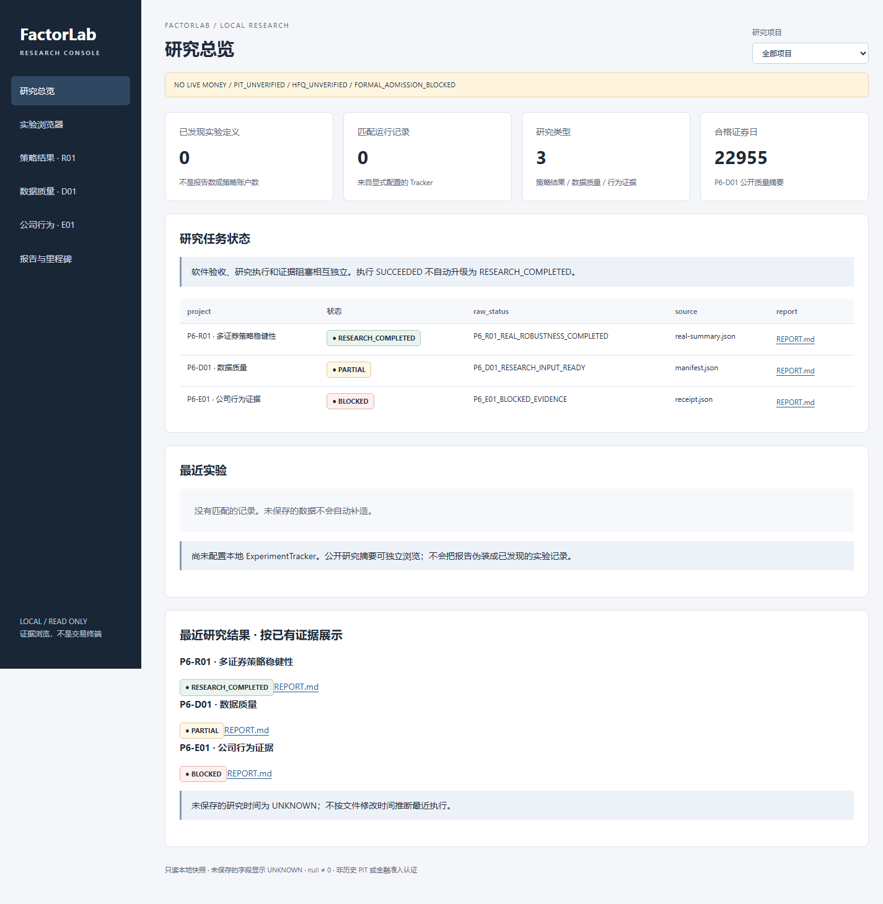
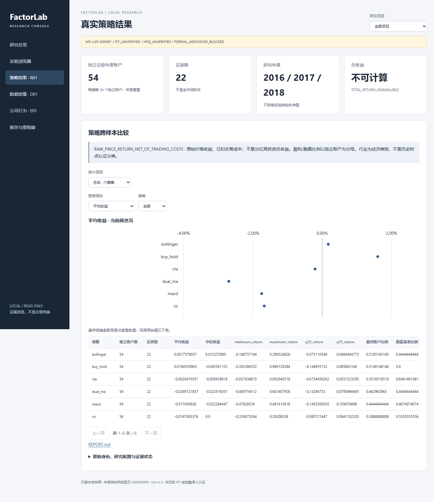
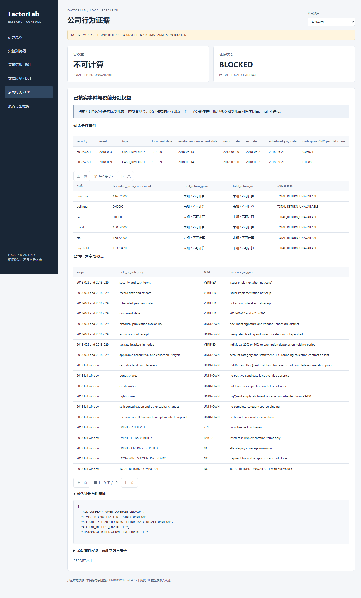

# P7-03：本地研究控制台与结果可视化

2026-11-10 · **P7_03_LOCAL_CONSOLE_ENGINEERING_ACCEPTED**

`NO LIVE MONEY / PIT_UNVERIFIED / HFQ_UNVERIFIED / FORMAL_ADMISSION_BLOCKED`

## 交付结论

已有公开研究结果可以通过本机浏览器集中查看。采用标准库 HTTP 服务与随包提供的原生页面，
无新增运行依赖、CDN 或前端构建流水线；只监听 IPv4 回环地址，研究目录保持只读。

实现基线为本次获取的 `origin/main @ 2fffbee`。本结论是控制台工程验收，不改变任何已有研究任务的结果或金融资格。

启动方式（仓库根目录、已安装 FactorLab 的 Python 3.13/3.14 环境）：

```powershell
python -m factorlab.console --config configs/console/public-research.json
```

打开 <http://127.0.0.1:8765>。完整配置及数据访问说明见[用户文档](../../user/research-console.md)。

## 展示与研究语义

研究总览、实验浏览器、P6-R01 策略结果、P6-D01 数据质量、P6-E01 公司行为证据和报告/里程碑六个视图均可访问。
项目筛选、实验详情展开、策略指标切换、年度与证券筛选、报告打开、身份与缺失数据查看均已完成浏览器交互检查。

原始状态与规范状态并列展示：R01 为 RESEARCH_COMPLETED；D01 为 PARTIAL，保持历史 PIT/HFQ 未认证；
E01 为 BLOCKED。SOFTWARE_ACCEPTED、RESEARCH_COMPLETED、PARTIAL、BLOCKED、NOT_RUN、UNKNOWN 分别处理；
未识别状态不会由文件名、执行 SUCCEEDED 或文件存在推断完成。

R01 直接使用公开 CSV，展示六策略的均值、中位数、盈利/跑赢比例、暴露、成本、年度、行业与逐证券剔除敏感性。
每策略 54 个独立证券年度账户，六策略共 324 行；不连成年际组合净值。图表与表格读取同一行、同一指标，
点图使用单色和位置表达单一数值，有零参考线、悬停/键盘数值与原始精度表格，不依赖多色策略编码。
收益明确为 RAW_PRICE_RETURN_NET_OF_TRADING_COSTS，总收益保持不可计算。

D01 公开质量摘要核对为 24 证券、22,955 合格证券日、445 拒绝证券日、43 合格连续区间；
年度覆盖、各证券拒绝原因及 Manifest SHA256 可查。E01 两起已核实现金分红和六策略税前权益可查，
`0.00000` 与 `null` 明确区分，后者显示“未知 / 不可计算”，TOTAL_RETURN_UNAVAILABLE 不变。

默认配置只含公开派生证据，没有私有 Tracker 路径，所以实验数显示 0；不会将研究报告伪造为实验记录。
显式加入本地存储后，复用 ExperimentTracker 的校验、query、compare 和 reproduction。
原构造器的写盘行为由控制台内部的只读适配层替代，查询索引只在内存中存在；研究引擎、记录格式和评估器未修改。

PR #69/#70/#71 的标题和链接来自本地基线提交记录，附快照日期与来源；GitHub/CI 当前状态为 UNKNOWN。
不会将此快照称为实时 GitHub 状态。

## 验证证据

Windows 11、Python 3.13.9：

```text
python -m pytest tests/research/test_console.py tests/research/test_experiment_tracker.py -q
31 passed in 7.71s
```

其中控制台定向测试 15 项，原 Tracker 测试 16 项，0 失败、0 跳过。
[JUnit 收据](tests.xml)覆盖发现/筛选/分页、状态、缺失、null/0、SHA、策略数值、身份比较、报告和 HTTP 只读约束。
路径穿越、编码路径、绝对路径、文件与 Tracker 符号链接逃逸、越界分页、重复参数、Host/Origin/跨站请求拒绝均通过。
读取前后合成研究存储的文件内容和修改时间一致，持久化 SQLite 未创建。

Microsoft Edge `158.0.4370.7` 本机 headless 浏览器，桌面视口 1440 × 1080：
[浏览器收据](browser-check.json)记录 17 项通过检查、0 个 JavaScript 异常。
除六个主视图外，实际执行指标切换并比对 SVG 中的原始来源值、2018 年筛选、601857.SH 筛选、身份展开、
项目筛选、null/0 展示和报告导航。单独配置的合成 Tracker 还完成详情、凭证遮蔽、相容比较、成本身份不相容拒绝及模型筛选。

wheel 与 sdist 构建成功；检查了 wheel 中 HTML/CSS/JS 和 sdist 中配置样例。
将 wheel 独立安装到临时目录后，从安装位置导入并通过实际 HTTP 读取首页、JS、CSS 和 D01 证据 API；
[安装包运行收据](package-check.json)为 PASS。

## 数据访问说明

仅配置的研究根目录与明确文件清单可读，API 使用登记的资源 ID；读取时重新验证真实路径包含关系。
单文件上限 8 MiB，表格上限每页 100 行，账户页 30 行。只传视图需要的 JSON 字段与分页表格，不传整个研究目录或大型逐日账本。

报告以纯文本或 PNG 打开，不执行 HTML；CSP、nosniff、禁止嵌入、Host/Origin 校验与无 CORS 共同限制浏览器侧访问。
非读取方法返回 405，无写入、命令执行、供应商文件下载或交易入口。
详情不传原命令和完整进程环境，凭证字段与绝对本地路径遮蔽；外部产物验证明确 NOT_RUN，不跟随 artifact 路径。
公开文件清单是操作者授权边界，默认不包含凭证或供应商原始数据。

## 页面截图

[总览](overview.png) · [实验空态](experiments.png) · [合成实验详情与比较](experiments-synthetic.png) ·
[策略](strategies.png) · [年度筛选](strategy-annual-filter.png) · [数据质量](quality.png) ·
[公司行为](evidence.png) · [报告与里程碑](reports.png)

合成实验截图仅用于工程交互验证，不是真实研究收益证据。






